<p align="center">
  
</p>

# Projeto Parque de Diversões

Aplicação desktop desenvolvida em **C# com Windows Forms e MySQL** para o atendimento de um parque de diversões. O sistema permite gerenciar visitantes, vender ingressos de brinquedos e eventos, incluir lanches na mesma compra e consultar o histórico de vendas.

O projeto aplica os conteúdos de Linguagem e Técnicas de Programação por meio de formulários orientados a eventos, modelos de domínio, acesso parametrizado ao banco e armazenamento de senhas com BCrypt.

**Desenvolvido por Luís Ferreira e Maria Cecília.**

## Demonstração

Assista ao vídeo para acompanhar o aplicativo em funcionamento.

https://github.com/user-attachments/assets/097bc6c8-7273-4dab-a556-084a315a1a43

## Funcionalidades

| Área | Recursos disponíveis |
| --- | --- |
| Acesso | Login de funcionário, exibição do nome e do cargo no atendimento e saída da sessão. |
| Visitantes | Cadastro, listagem, busca por nome ou e-mail, edição e exclusão com confirmação. |
| Catálogo | Consulta de ingressos de brinquedos e eventos e de lanches em abas da tela principal. |
| Sacola | Inclusão de itens com quantidade, soma de itens repetidos, remoção e cálculo de subtotais e total. |
| Venda | Seleção do visitante, escolha da forma de pagamento, confirmação e gravação da compra com seus itens. |
| Histórico | Listagem das compras, consulta dos itens de cada venda e exclusão da compra com confirmação. |

As formas de pagamento registradas são **PIX, dinheiro, cartão de crédito e cartão de débito**. O funcionário seleciona a forma utilizada pelo visitante durante o atendimento.

## Instalação e execução

### Pré-requisitos

- Windows para executar os formulários Windows Forms.
- SDK do .NET 10.
- Servidor MySQL compatível com o script, que utiliza a collation `utf8mb4_0900_ai_ci`, disponível a partir do MySQL 8.0.
- HeidiSQL ou MySQL Workbench para importar o banco.
- Git para clonar o repositório.
- Para abrir pelo Visual Studio, uma versão compatível com .NET 10 e a carga de trabalho **Desenvolvimento para desktop com .NET**.

### 1. Obter o projeto

```powershell
git clone https://github.com/luisferreiira/parque-csharp.git
cd parque-csharp
```

### 2. Preparar o banco

1. Inicie o servidor MySQL e conecte-se por meio do HeidiSQL ou do MySQL Workbench.
2. Abra o arquivo [banco/sql_projeto_parque_csharp.sql](banco/sql_projeto_parque_csharp.sql).
3. Execute o script completo e confirme a criação do banco `projeto_parque`.

> O script contém `DROP DATABASE` e recria o banco `projeto_parque`, apagando os dados anteriores desse banco. Use uma instância de desenvolvimento e faça backup se precisar preservar informações.

O arquivo reúne tabelas, dados iniciais, procedures e triggers utilizados pela aplicação.

### 3. Configurar a conexão

Em [ProjetoParqueCSharp/DAO/Connection.cs](ProjetoParqueCSharp/DAO/Connection.cs), ajuste o campo `stringConexao` conforme a sua instalação do MySQL.

| Configuração | Valor esperado pelo projeto |
| --- | --- |
| Servidor | `localhost` |
| Porta | `3307` |
| Banco | `projeto_parque` |
| Usuário | `root` |
| Senha | Ajustar `Pwd` para a senha do usuário MySQL local. |

Se o seu servidor usar a porta `3306`, altere `Port` na conexão. Mantenha as credenciais pessoais da sua instalação fora dos commits.

### 4. Compilar e executar

Na raiz do repositório, execute os comandos abaixo.

```powershell
dotnet restore ProjetoParqueCSharp/ProjetoParqueCSharp.csproj
dotnet build ProjetoParqueCSharp/ProjetoParqueCSharp.csproj
dotnet run --project ProjetoParqueCSharp/ProjetoParqueCSharp.csproj
```

Pelo Visual Studio, abra [ProjetoParqueCSharp/ProjetoParqueCSharp.slnx](ProjetoParqueCSharp/ProjetoParqueCSharp.slnx), aguarde a restauração dos pacotes e execute o projeto com **F5**.

### 5. Primeiro acesso

Após importar o banco, use a conta demonstrativa no formulário de login.

| Campo | Valor |
| --- | --- |
| E-mail | `admin` |
| Senha | `admin` |

Essa conta está incluída nos dados iniciais para avaliação do projeto. O campo de e-mail aceita o identificador `admin` dessa conta demonstrativa. O acesso ao MySQL usa as credenciais configuradas na etapa anterior.

## Como utilizar

1. **Entre no sistema** com a conta de funcionário.
2. **Cadastre um visitante** pelo botão Visitantes ou utilize um cadastro existente. A busca é executada ao pressionar Enter.
3. **Selecione o visitante da compra** no botão Selecionar visitante.
4. **Monte a sacola** nas abas Brinquedos, Eventos e Lanches. Informe a quantidade e clique em Adicionar. O total é atualizado a cada alteração.
5. **Escolha a forma de pagamento** e clique em Finalizar compra. Confira o visitante e o valor na confirmação.
6. **Consulte a venda** em Ver histórico e selecione a compra para visualizar os itens registrados.

Ao concluir uma compra, a aplicação limpa a sacola e a seleção do visitante para iniciar o próximo atendimento. Se a gravação falhar, a sacola permanece disponível para correção.

## Formulários

Os arquivos dos formulários ficam em [ProjetoParqueCSharp/Forms](ProjetoParqueCSharp/Forms).

| Formulário | Responsabilidade |
| --- | --- |
| `LoginFuncionario` | Recebe as credenciais, consulta o funcionário e verifica a senha. Envia código, nome e cargo para o atendimento. |
| `Principal` | Centraliza o catálogo, a sacola, o visitante selecionado e a finalização da compra. Abre o gerenciamento de visitantes e o histórico. |
| `GerenciarVisitantes` | Permite cadastrar, buscar, editar e excluir visitantes, com validação dos campos. |
| `SelecionarVisitante` | Filtra visitantes por nome ou e-mail e devolve o código e o nome escolhidos para a compra. |
| `HistoricoCompras` | Apresenta as vendas e seus itens e permite excluir uma compra completa. |

Cada formulário possui o arquivo `.cs` com os eventos e a lógica, o `.Designer.cs` com a configuração dos controles e o `.resx` com os recursos associados.

## Organização do código

```text
parque-csharp/
├── README.md
├── banco/
│   └── sql_projeto_parque_csharp.sql
└── ProjetoParqueCSharp/
    ├── Program.cs
    ├── ProjetoParqueCSharp.csproj
    ├── ProjetoParqueCSharp.slnx
    ├── DAO/
    │   └── Connection.cs
    ├── Forms/
    │   ├── LoginFuncionario.cs
    │   ├── Principal.cs
    │   ├── GerenciarVisitantes.cs
    │   ├── SelecionarVisitante.cs
    │   ├── HistoricoCompras.cs
    │   └── IdentidadeVisual.cs
    ├── Model/
    │   ├── Entidade/
    │   ├── Brinquedo/
    │   ├── Evento/
    │   ├── Lanche/
    │   ├── Compra/
    │   └── Sacola/
    ├── Service/
    │   └── Hash.cs
    ├── Images/
    └── Properties/
```

### Classes de apoio

| Classe | Papel no projeto |
| --- | --- |
| `Program` | Inicializa o Windows Forms, apresenta o login e controla a abertura do atendimento e o retorno ao login. |
| `Connection` | Centraliza a conexão MySQL, comandos parametrizados, chamadas de procedures, operações de visitantes e compras e mensagens de erro. |
| `Hash` | Oferece `CriarHash` para gerar o hash BCrypt e `VerificarSenha` para conferir a senha digitada. |
| `IdentidadeVisual` | Carrega o ícone das janelas e o logotipo usado no menu. |

### Entidades e modelos

As classes de [Model](ProjetoParqueCSharp/Model) representam os dados do domínio e os itens preparados durante a venda.

| Pasta | Classes | Dados representados |
| --- | --- | --- |
| `Entidade` | `Visitante`, `Funcionario` | Identificação dos visitantes e funcionários, dados cadastrais e credenciais. O funcionário também possui vínculo com o cargo. |
| `Brinquedo` | `Brinquedo`, `IngressoBrinquedo` | Atrações, capacidade, idade mínima, funcionamento e tipos e valores de ingressos. |
| `Evento` | `Evento`, `IngressoEvento` | Eventos, local, período, descrição e ingressos associados. |
| `Lanche` | `Lanche`, `Categoria` | Produtos, preços, descrição e categoria do lanche. |
| `Compra` | `Compra` | Identificador da venda, data, pagamento, visitante e funcionário responsável. |
| `Compra` | `CompraIngressoBrinquedo`, `CompraIngressoEvento`, `CompraLanche` | Vínculo entre a compra e cada produto ou ingresso, incluindo a quantidade. |
| `Sacola` | `Sacola`, `ItemSacola` | Lista em memória com tipo, código, descrição, quantidade, valor unitário e subtotal de cada item. |

A `Sacola` reúne os itens durante o atendimento. Na finalização, `GravarCompra` registra a `Compra` e os itens correspondentes ao tipo `IngressoBrinquedo`, `IngressoEvento` ou `Lanche` dentro de uma transação.

## Validações e persistência

- **Visitantes** têm nome obrigatório, nascimento limitado à data atual, e-mail opcional com validação de formato e senha obrigatória no cadastro, com mínimo de seis caracteres.
- **E-mail duplicado** é tratado com uma mensagem ao funcionário. A atualização dos dados do visitante utiliza um único `UPDATE`.
- **Senhas** são armazenadas como hashes BCrypt. Na edição, deixar a senha em branco preserva o hash anterior. A verificação utiliza o fator de trabalho contido no próprio hash.
- **Seleção do visitante** é conferida ao fechar o gerenciamento. O nome é atualizado após uma edição e a seleção é limpa se o cadastro tiver sido excluído.
- **Exclusão de visitante** solicita confirmação e é bloqueada quando há compras vinculadas.
- **Itens da sacola** aceitam quantidades inteiras maiores que zero. Adições repetidas do mesmo tipo e código somam as quantidades.
- **Finalização da compra** exige visitante, itens e forma de pagamento. A gravação da venda e dos itens utiliza uma transação com confirmação ao término.
- **Regras de atrações** são aplicadas por triggers do MySQL, incluindo verificações de idade, funcionamento do brinquedo, capacidade e validade de ingressos de eventos.
- **Histórico** permite consultar os itens e excluir a compra completa mediante confirmação.

O banco também reúne registros de auditoria e procedures de consulta e relatórios. Os formulários acessam o banco por meio da classe `Connection`, que usa `MySqlParameter` para enviar os parâmetros das operações.

## Tecnologias

| Tecnologia | Utilização |
| --- | --- |
| C# / .NET 10 | Linguagem e plataforma da aplicação. |
| Windows Forms | Formulários, controles visuais e eventos de interação. |
| MySQL | Persistência, relacionamentos, procedures e triggers. |
| `MySql.Data` 26.10.0 | Comunicação entre a aplicação C# e o MySQL. |
| `BCrypt.Net-Next` 4.2.0 | Geração e verificação dos hashes de senha. |

As dependências são declaradas no arquivo `.csproj` e restauradas pelo NuGet.

## Roteiro de demonstração e validação

1. Fazer login com a conta demonstrativa e conferir o nome e o cargo no atendimento.
2. Cadastrar um visitante de teste, pesquisá-lo e editar seus dados.
3. Tentar editar nome e nascimento usando um e-mail já cadastrado e conferir que a operação foi recusada sem alterações parciais.
4. Editar um visitante com senha em branco e conferir a preservação do hash no banco.
5. Selecionar um visitante para compra, alterar seu nome no gerenciamento e conferir o nome atualizado na Principal.
6. Selecionar um visitante de teste sem compras, excluí-lo e conferir a limpeza da seleção e o bloqueio da finalização sem visitante.
7. Registrar uma compra com ingresso e lanche, conferindo quantidades, total e forma de pagamento.
8. Consultar a compra no histórico e conferir os itens. Tentar excluir o visitante com compra vinculada para verificar o bloqueio.
9. Usar um visitante menor de idade para verificar a recusa de um ingresso com restrição de idade.

Para gravar o vídeo, esse roteiro pode ser reduzido a login, cadastro e edição de visitante, compra mista e histórico, mostrando as mensagens de validação durante a navegação.

## Solução de problemas

| Situação | O que conferir |
| --- | --- |
| Falha de conexão | Serviço MySQL iniciado, servidor, porta, usuário e senha em `Connection.cs`. |
| Procedure ausente ou quantidade de parâmetros incorreta | Banco criado com o script atualizado deste repositório. Ao atualizar um banco com dados, recrie apenas as rotinas alteradas. |
| Credenciais recusadas | Importação dos dados iniciais e uso da conta demonstrativa no formulário de login. |
| SDK ou framework indisponível | Instalação do SDK .NET 10 e compatibilidade da versão do Visual Studio. |
| Executável bloqueado durante a compilação | Fechar a instância aberta do Projeto Parque e compilar novamente. |
| Interface apresenta comportamento anterior à alteração | Recompilar o projeto e abrir uma nova instância. |

## Integrantes

- Luís Ferreira — [luisferreiira](https://github.com/luisferreiira)
- Maria Cecília — [mariaceciliall3](https://github.com/mariaceciliall3)
